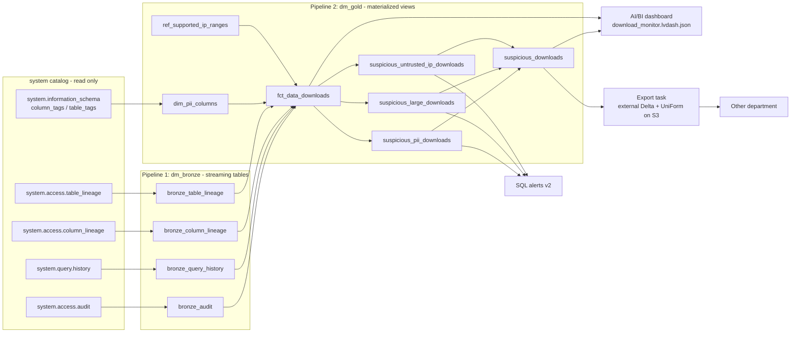

# Plan: data download monitor on Databricks system tables

Status: **plan only, nothing built yet.** This document describes what will be added to this bundle, in which
order, and what has to be confirmed in the workspace before each step.

The goal is to find **suspicious data downloads**:

1. downloads that touch **sensitive data**, meaning columns (or tables) carrying the governed tag `PII`;
2. downloads of **large amounts of data**;
3. downloads from **IP addresses outside an approved list**;

across the client applications people actually use: **AI/BI dashboards, the Databricks UI (SQL editor, notebooks,
Genie, file browser) and Excel** (plus other ODBC/JDBC tools, which look the same as Excel to the platform).

> **Verification status.** docs.databricks.com could not be reached from the session that wrote this plan, so the
> Databricks facts below come from the [andyweaves/system-tables-audit-logs](https://github.com/andyweaves/system-tables-audit-logs)
> repository (which was read) and prior knowledge of the platform. Anything marked **⚠ verify** must be confirmed
> against the docs or in the workspace during [Phase 0](#phase-0--discovery-in-the-workspace-before-writing-code).
> The design is built so that these facts live in config, not in code, so a wrong guess is a config change.

---

## 1. Architecture at a glance



| # | Deliverable | Databricks feature | Bundle resource |
|---|---|---|---|
| 1 | Bronze: system tables copied incrementally | Lakeflow Spark Declarative Pipeline, **streaming tables** | `pipelines.dm_bronze` |
| 2 | Gold: download facts and suspicious-activity views | Same, **materialized views** | `pipelines.dm_gold` |
| 3 | Dashboard | AI/BI (Lakeview) dashboard, `.lvdash.json` | `dashboards.download_monitor` |
| 4 | Alerts | Databricks SQL **alerts v2** | `alerts.*` |
| 5 | S3 export | UC external location + external Delta table (UniForm/Iceberg readable) | `jobs.dm_export` task |
| - | Orchestration | One job: bronze → gold → export | `jobs.download_monitor` |

Everything is deployed by the existing bundle (`databricks.yml` already includes `resources/**/*.yml`) and runs on
**serverless** compute, like the Wanderbricks pipelines.

---

## 2. Key design decisions (and why)

### 2.1 "Download" needs two sources, not one

There is no single "download" event. The plan treats a download as either:

| Kind | Where it is recorded | Examples |
|---|---|---|
| **Explicit download / export** | `system.access.audit` action events | "Download CSV" in a notebook or SQL editor, dashboard data download, workspace export, file download from volumes, model artifact download |
| **Result set pulled by an external client** | `system.query.history` (rows returned) | Excel (add-in or ODBC), Power BI/Tableau, JDBC/ODBC tools, SQL connectors. These never click "download"; every result they fetch *is* the download |

The **Excel** requirement can only be met through the second kind, so `system.query.history` is essential, not
optional. Both kinds end up in one fact table, `fct_data_downloads`, with a `download_kind` column.

Audit actions used for explicit downloads (from the andyweaves `data_downloads_from_control_plane` detection):

| Action | Channel | Notes |
|---|---|---|
| `downloadPreviewResults`, `downloadLargeResults` | Notebook UI | |
| `downloadQueryResult` (where `request_params.fileType != 'arrows'`) | SQL editor / dashboards | `arrows` is the in-browser result fetch, not a download |
| `workspaceExport` (where `request_params.workspaceExportFormat != 'SOURCE'`) | Workspace export | notebook exported with outputs |
| `filesGet` | Files / volumes | |
| `getModelVersionDownloadUri`, `getModelVersionSignedDownloadUri` | Model registry | in scope only if models can carry PII; default off |

**⚠ verify:** the AI/BI dashboard and Genie download actions and whether `downloadQueryResult` carries a statement or
query-result id we can join to `system.query.history`. The action list lives in
`config/download_monitor/download_actions.yml`, so it is extended without code changes.

### 2.2 The join chain

```
audit download event ──(statement id in request_params ⚠)──┐
                                                          ├─> query.history  (rows, client_application, query_source)
external-client query (query.history) ────────────────────┘          │
                                                                     ├─(statement_id)─> column_lineage ─> PII columns
                                                                     └─(statement_id)─> table_lineage  ─> PII tables
audit (same user/session, verbose audit) ──────────────────────────> source_ip_address for external-client queries
```

| Join | Key | Confidence |
|---|---|---|
| query.history → column_lineage / table_lineage | `statement_id` | high (**⚠ verify** coverage for plain `SELECT` reads, see 2.3) |
| audit download → query.history | statement / query-result id in `request_params` | **⚠ verify in Phase 0**; fallback: same user + statement ending within N seconds before the download |
| query.history → IP address | query.history has **no IP column**. With **verbose audit logs** on, `databrickssql` command events carry the IP and command id | **⚠ verify**; fallback: `session_id`, then the user's latest authentication event IP |

**Recommendation: turn on verbose audit logs** in each workspace in scope (workspace admin setting). Without them,
IP attribution for Excel/ODBC queries is best-effort only, and the plan reports it as `ip_attribution = 'inferred'`.

### 2.3 Detecting PII: three levels of evidence

Column lineage is the precise signal, but lineage is not always captured (e.g. some notebook paths, `SELECT *`
through views, unsupported compute). Rather than miss those downloads, every download gets a `pii_evidence` value:

| `pii_evidence` | Rule | Meaning |
|---|---|---|
| `column` | a source column in `column_lineage` for this statement has tag `PII` | the download contains PII |
| `table` | a source table in `table_lineage` for this statement has a `PII` column or a `PII` table/schema/catalog tag | the download *may* contain PII |
| `text` | no lineage, but `statement_text` references a table on the PII list | weak; only for review |
| `none` | none of the above | |

`dim_pii_columns` is built from `system.information_schema.column_tags`, plus `table_tags`, `schema_tags` and
`catalog_tags` so a tag set higher up is inherited by every column below it. Tag matching is case-insensitive on
`tag_name = 'PII'`; `tag_value` (e.g. `email`, `ssn`) is kept for the dashboard. **⚠ confirm** with the data
governance owner what values the governed tag allows.

Two caveats to design around:

- **`information_schema` is filtered by the reader's privileges.** The gold pipeline's run-as identity (a service
  principal) must be able to see every tagged object, at least `BROWSE` on the catalogs in scope, or PII columns
  silently disappear from `dim_pii_columns`. Phase 0 checks the count against what an admin sees.
- **Tags change over time.** v1 evaluates downloads against the *current* tags. v2 (optional) snapshots tags daily
  with `create_auto_cdc_from_snapshot_flow` into an SCD type 2 table so a download is judged against the tags in
  force when it happened.

Optional enhancement: if Data Classification is enabled, `system.data_classification.results` (**⚠ verify**) can
flag columns that *look* like PII but are not tagged yet; a dashboard tile "untagged PII candidates downloaded" would
show gaps in tagging.

### 2.4 Why copy the system tables into bronze at all

System tables are already Delta tables, so the bronze layer has to earn its cost:

- **Retention.** System tables keep a limited window (about a year for audit and query history; **⚠ verify** per
  table). Investigations and the other department may need longer. Bronze keeps everything.
- **Evidence.** A frozen copy under our own governance, with our own grants.
- **Performance.** Bronze is liquid-clustered on the keys gold joins on (`event_date`, `statement_id`, `action_name`).
- **Incremental gold.** Materialized views over Delta streaming tables we own refresh incrementally more often than
  over shared system tables.

### 2.5 Two pipelines, and bronze protected from full refresh

Bronze and gold are **separate pipelines**. A full refresh of a streaming table re-reads its source from the start,
and the source only holds the retention window, so a full refresh of bronze would **permanently delete history
older than the window**. The bronze tables therefore set `pipelines.reset.allowed = false`. Gold can be fully
refreshed at any time because it is fully derived from bronze.

### 2.6 Streaming from system tables: recommended options

Following the system tables guidance on streaming (**⚠ verify** exact wording on the docs page):

- Read with `.option("skipChangeCommits", "true")`. System tables receive non-append commits (retention deletes,
  late corrections). Without this option those commits make the stream fail.
- Use **triggered** (scheduled) pipeline updates, not continuous: system tables land with a delay of minutes to
  hours, so a continuous pipeline costs money and gains nothing. Hourly is the default.
- Deduplicate on the natural key (`event_id` for audit, `statement_id` + `update_time` for query history, `record_id`
  for lineage) in gold, not in bronze, so bronze stays a faithful copy.
- Optionally bound the very first run (the initial backfill of up to a year of audit logs) with a config
  `bronze_start_date`, applied as a filter, so the first update finishes in reasonable time.

### 2.7 Materialized views kept incremental

- **No `current_date()` / `current_timestamp()` inside the materialized views.** Non-deterministic functions force a
  full recompute on every refresh. Rolling windows ("last 24 hours") go in the dashboard and alert queries, which run
  on a SQL warehouse.
- Thresholds and IP ranges come from small reference tables, not hard-coded literals, so tuning does not need a
  redeploy of code.

### 2.8 Suspicious-activity rules (v1 defaults, all configurable)

| Rule | View | Default trigger |
|---|---|---|
| PII download | `suspicious_pii_downloads` | `pii_evidence IN ('column','table')` |
| Large single download | `suspicious_large_downloads` | `rows_returned >= 100,000` (andyweaves has no row rule; this is a starting value to tune) |
| Download burst | `suspicious_large_downloads` | `> 20` download events by one user in 60 minutes (andyweaves threshold) |
| Large daily volume | `suspicious_large_downloads` | user's daily rows `>= 1,000,000`, or `>= 5x` their trailing 30-day median (v2) |
| Untrusted IP | `suspicious_untrusted_ip_downloads` | `source_ip` not inside any CIDR in `ref_supported_ip_ranges`, after stripping the port |

`suspicious_downloads` unions the three with a `reasons` array and a simple additive `risk_score`
(PII 50, untrusted IP 30, large 20, so PII + untrusted IP + large = 100). This is the table the export and the
dashboard's triage list read.

Exclusions: service principals and `System-User` on an allowlist (scheduled dashboard refreshes and jobs are not
people downloading), private/loopback addresses (`127.0.0.1`, `0.0.0.0`, empty) treated as "internal", and IPv6
addresses flagged as `unparsed` (counted as untrusted until IPv6 ranges are added to the list).

Notebook UI downloads (`downloadPreviewResults`/`downloadLargeResults`) on classic clusters have no row count, since
those statements are not in `query.history`; they are caught by the burst rule and the PII rule (via notebook
lineage where available) but not by the row rule.

### 2.9 Client application classification

A config-driven mapping (`config/download_monitor/client_channels.yml`) turns `query.history.client_application`,
`client_driver`, `query_source` and the audit `user_agent` into one `channel`:

| `channel` | Matched by (initial guesses, **⚠ verify** values in Phase 0) |
|---|---|
| `dashboard` | `query_source.dashboard_id` / `legacy_dashboard_id` not null |
| `genie` | `query_source.genie_space_id` not null |
| `sql_editor` | `client_application` like `%SQL Editor%` |
| `notebook` | `query_source.notebook_id` not null, or notebook download actions |
| `excel` | `client_application` / `user_agent` like `%Excel%` |
| `odbc_jdbc_other` | `client_driver` ODBC/JDBC, or user agent of Simba/Databricks drivers, not matched above |
| `api_connector` | Python/Go/Node SQL connectors, REST statement execution API |
| `workspace_export`, `files` | from the audit action |

Pure-Python matching logic (so it is unit-testable offline, like the existing generators), applied in the pipeline.

### 2.10 Our own tables are sensitive

The gold tables hold user emails, IPs and query text. They get the `PII` governed tag themselves, grants are limited
to the security team, and the export only contains the columns the receiving department is approved for (see 6).

---

## 3. Proposed repository layout

Follows the repo's existing split of `resources/` (YAML), `src/` (pipeline code), `config/` (tunable data),
`tests/` (offline) and `docs/`.

```
config/download_monitor/
  download_actions.yml         # audit action names -> download kind/channel (2.1)
  client_channels.yml          # client_application/user_agent patterns -> channel (2.9)
  supported_ip_ranges.csv      # approved CIDRs: cidr, description, owner
  thresholds.yml               # rule thresholds (2.8), excluded principals
resources/download_monitor/
  schemas.yml                  # dm_bronze, dm_gold, dm_export schemas
  bronze_pipeline.yml          # pipelines.dm_bronze
  gold_pipeline.yml            # pipelines.dm_gold
  job.yml                      # jobs.download_monitor (bronze -> gold -> export), paused by default
  dashboard.yml                # dashboards.download_monitor
  alerts.yml                   # alerts.dm_*
  export.yml                   # external location reference + export task config
src/download_monitor/
  common/classify.py           # pure Python: IP/CIDR matching, channel classification, config loading
  bronze/system_tables.py      # 4 streaming tables
  gold/reference.py            # dim_pii_columns, ref_supported_ip_ranges, ref_thresholds
  gold/downloads.py            # fct_data_downloads
  gold/suspicious.py           # suspicious_* views
  export/export_to_s3.py       # idempotent export of trailing window
  dashboards/download_monitor.lvdash.json
tests/download_monitor/
  test_classify.py             # CIDR, port stripping, IPv6, channel mapping
  test_config.py               # config files valid, thresholds sane, CIDRs parse
  test_bundle_wiring.py        # every ${var.*}/${resources.*} resolves (extends tests/test_bundle_wiring.py)
  test_dashboard.py            # lvdash.json parses, every dataset references an existing gold table
docs/download_monitor/
  PLAN.md                      # this file
  README.md                    # how to deploy, operate and tune (written at the end)
  runbook.md                   # what to do when each alert fires
```

New bundle variables (in `databricks.yml`):

| Variable | Default | Purpose |
|---|---|---|
| `dm_catalog` | `${var.catalog}` | catalog for the monitor schemas |
| `dm_bronze_schema` / `dm_gold_schema` / `dm_export_schema` | `dm_bronze` / `dm_gold` / `dm_export` | |
| `dm_warehouse_id` | none (required) | SQL warehouse for dashboard and alerts |
| `dm_alert_emails` | none (required) | alert recipients (or a notification destination id) |
| `dm_export_s3_url` | none (required for export) | e.g. `s3://<bucket>/security/download_monitor/` |
| `dm_pause_status` | `PAUSED` | job schedule switch, same pattern as the orchestration alternatives |
| `dm_bronze_start_date` | empty | optional lower bound for the initial backfill |

---

## 4. Bronze: streaming tables

Pipeline `dm_bronze`, serverless, triggered, `channel: CURRENT`, run as a service principal.

| Table | Source | Cluster by | Notes |
|---|---|---|---|
| `bronze_audit` | `system.access.audit` | `event_date`, `service_name`, `action_name` | full copy, not just downloads: investigations need logins and permission changes around a download |
| `bronze_query_history` | `system.query.history` | `start_time`, `statement_id` | full copy; a statement can appear more than once as it progresses (keep all, dedupe in gold on latest `update_time`) |
| `bronze_column_lineage` | `system.access.column_lineage` | `event_date`, `statement_id` | |
| `bronze_table_lineage` | `system.access.table_lineage` | `event_date`, `statement_id` | fallback PII evidence (2.3) |

Shape of each table (illustrative):

```python
from pyspark import pipelines as dp

BRONZE_PROPS = {"pipelines.reset.allowed": "false", "delta.enableRowTracking": "true"}

@dp.table(
    name="bronze_audit",
    comment="Append-only copy of system.access.audit.",
    cluster_by=["event_date", "service_name", "action_name"],
    table_properties=BRONZE_PROPS,
)
@dp.expect("has_event_id", "event_id IS NOT NULL")
def bronze_audit():
    df = spark.readStream.option("skipChangeCommits", "true").table("system.access.audit")
    start = spark.conf.get("bronze_start_date", "")
    return df.where(f"event_date >= '{start}'") if start else df
```

Expectations are **warn-only** in bronze (`@dp.expect`, never `expect_or_drop`): bronze must not lose audit records.

---

## 5. Gold: materialized views

Pipeline `dm_gold`, serverless, triggered after bronze by the job.

| View | Grain | Purpose |
|---|---|---|
| `ref_supported_ip_ranges` | one row per CIDR | loaded from `supported_ip_ranges.csv` (bundle-synced file), with `start_int`/`end_int` for IPv4 range joins |
| `ref_thresholds` | one row per rule | from `thresholds.yml` |
| `dim_pii_columns` | catalog.schema.table.column | from `information_schema` tags with inheritance (2.3) |
| `dim_pii_tables` | catalog.schema.table | tables with at least one PII column, or tagged at table level or above |
| `fct_query_results` | `statement_id` (latest update) | deduped query history + `channel` + IP attribution |
| `fct_data_downloads` | one row per download | union of explicit downloads (audit) and external-client results (query history), enriched with rows, `channel`, `source_ip`, `ip_trusted`, `pii_evidence`, `pii_columns[]`, `pii_tag_values[]` |
| `suspicious_pii_downloads` | download | rule 1 |
| `suspicious_large_downloads` | download, or user×hour / user×day for burst and volume rules | rule 2 |
| `suspicious_untrusted_ip_downloads` | download | rule 3 |
| `suspicious_downloads` | download | union + `reasons[]` + `risk_score`; feeds dashboard triage, alerts and export |
| `daily_download_summary` | day × workspace × channel | dashboard trends |

Key columns of `fct_data_downloads`:

`download_id, event_time, event_date, workspace_id, user_email, is_service_principal, download_kind
(explicit|external_client), action_name, channel, client_application, client_driver, statement_id, query_source_id,
rows_returned, read_bytes, source_ip, ip_trusted, ip_attribution (direct|verbose_audit|session|inferred|none),
pii_evidence, pii_columns, pii_tag_values, source_tables, statement_text_preview`

The fact table is where all the joins happen once, so the suspicious views, the dashboard and the alerts stay simple
filters over it.

---

## 6. S3 export for the other department

**Recommended: an external Delta table with UniForm (Iceberg) in the department's S3 bucket, written by a job task.**

- A UC **storage credential** (IAM role) and **external location** on `s3://<bucket>/security/download_monitor/`,
  created once by an admin (outside the bundle, or with the bundle's `external_locations` resource if the CLI
  version supports it, **⚠ verify**).
- External table `dm_export.suspicious_downloads` at that location, partitioned by `event_date`, with
  `delta.universalFormat.enabledFormats = 'iceberg'`. The other department can read it as **Delta or Iceberg**
  (Athena, Glue, Snowflake, Spark, Trino) without a Databricks account, and it stays governed by Unity Catalog on our
  side.
- The export task overwrites a trailing window idempotently, because gold can still change for recent days when
  late system-table data arrives:

  ```sql
  INSERT INTO dm_export.suspicious_downloads
  REPLACE WHERE event_date >= date_sub(current_date(), 3)
  SELECT <approved columns> FROM dm_gold.suspicious_downloads
  WHERE event_date >= date_sub(current_date(), 3);
  ```

- Export columns are an explicit, reviewed list (no `statement_text`, possibly hashed emails) agreed with the
  receiving team and the privacy owner.

Why not the alternatives:

| Option | Verdict |
|---|---|
| **Delta Sharing** | Databricks' preferred way to share with another team, live and without copies. Use this **instead** if the other department can consume Delta Sharing (open connectors exist for pandas, Spark, Power BI). The requirement says S3, so this is the fallback recommendation, not the plan. |
| Pipeline **sink** (`dp.create_sink`) | Append-only streaming, but the gold layer is materialized views (not streamable) and recent rows must be rewritten, so it does not fit. |
| CSV/JSON files | Only if the consumer cannot read Parquet; loses schema and needs a manifest. Can be added as a second export format. |
| Schema with managed location on their bucket | Consumers must not read managed table paths directly. Rejected. |

---

## 7. Dashboard

AI/BI dashboard `src/download_monitor/dashboards/download_monitor.lvdash.json`, deployed by
`resources/download_monitor/dashboard.yml` with `warehouse_id: ${var.dm_warehouse_id}`. (The `dashboard.json` you
asked for is this file; AI/BI dashboards use the `.lvdash.json` extension.) It is designed in the UI once against the
real gold tables, exported with `databricks bundle generate dashboard`, then edited in git.

Global filters: date range, workspace, channel, user, `ip_trusted`, `pii_evidence`.

| Page | Widgets |
|---|---|
| **Overview** | counters: downloads, suspicious downloads, PII downloads, untrusted-IP downloads, rows downloaded; trend of downloads by channel per day; risk score distribution |
| **Triage** | table of `suspicious_downloads` sorted by risk score, with reasons, user, channel, IP, rows, PII columns; link to the dashboard/query/notebook id |
| **Sensitive data** | PII downloads by tag value, by table, by user; top PII columns downloaded; share of downloads with only `table`-level evidence (lineage gaps) |
| **Large downloads** | rows per download (histogram), top users by daily volume, burst events |
| **IP addresses** | downloads by IP and by /24 range, trusted vs untrusted over time, IPs seen for the first time; optional geolocation (andyweaves' MaxMind approach) in v2 |
| **User drill-down** | everything one user downloaded, with channels and IPs over time |
| **Data quality** | bronze freshness (max `event_time` per table), share of downloads with no IP attribution, with no lineage |

The *Data quality* page matters: it shows when a detection is blind (e.g. verbose audit off, lineage missing).

---

## 8. Alerts

Databricks SQL **alerts v2**, defined in `resources/download_monitor/alerts.yml` with inline `query_text`, as the
andyweaves bundle path does (**⚠ verify** minimum CLI version, the andyweaves repo requires 0.288.0+ and
`engine: direct`). Each alert queries a suspicious view over a rolling window and notifies `${var.dm_alert_emails}`.

| Alert | Query (shape) | Condition | Schedule |
|---|---|---|---|
| `dm_pii_download` | `suspicious_pii_downloads` in last 2 hours, `pii_evidence = 'column'` | count > 0 | hourly, :20 |
| `dm_untrusted_ip_download` | `suspicious_untrusted_ip_downloads` in last 2 hours | count > 0 | hourly, :20 |
| `dm_large_download` | `suspicious_large_downloads` in last 2 hours | count > 0 | hourly, :20 |
| `dm_high_risk_download` | `suspicious_downloads` with `risk_score >= 80` in last 2 hours | count > 0 | hourly, :20 |
| `dm_pipeline_stale` | max `event_time` in `bronze_audit` | older than 6 hours | every 3 hours |

Settings for all: `empty_result_state: OK` (zero rows is good news, not an error), a custom subject/body with the
result table and links (`{{QUERY_RESULT_TABLE}}`, `{{ALERT_URL}}`) like andyweaves, and a re-trigger interval of
1 hour so a single incident does not page every run. The 2-hour window with an hourly schedule tolerates system
table latency; alerts deduplicate by `download_id` in the notification body. Each alert has a section in
`runbook.md`.

The job also gets an `on_failure` email notification, so a broken pipeline is not mistaken for "nothing suspicious".

---

## 9. Orchestration

`jobs.download_monitor` (hand-written, the repo's baseline pattern), hourly, `pause_status: ${var.dm_pause_status}`,
`max_concurrent_runs: 1`:

1. `bronze` → `pipeline_task: dm_bronze`
2. `gold` → `pipeline_task: dm_gold` (depends on 1)
3. `export` → `export_to_s3.py` on serverless (depends on 2)

Alerts run on their own schedules a little after the job's typical finish time. (A table-update trigger on
`suspicious_downloads` would be tighter; it is a v2 option, see the trigger caveats in
[docs/orchestration](../orchestration/README.md).)

---

## 10. Permissions and prerequisites

| Who | Needs | Granted by |
|---|---|---|
| Metastore admin | enable the `access` and `query` system schemas (**⚠ verify** they are enabled; `query` may need enabling) | account/metastore admin |
| Workspace admins | **verbose audit logs** on in every workspace in scope | workspace admin |
| Pipeline/job service principal | `USE CATALOG system`, `USE SCHEMA` + `SELECT` on `system.access`, `system.query`; `BROWSE` on every catalog with PII tags; `CREATE TABLE` in the `dm_*` schemas | metastore admin |
| Export service principal | `WRITE FILES` / `CREATE EXTERNAL TABLE` on the external location | metastore admin |
| Security team | `SELECT` on `dm_gold`, `CAN_VIEW` on dashboard, alert recipients | bundle `permissions` |
| Other department | read on the S3 prefix (IAM, their side) | AWS account owner |

Scope note: `system.access.audit` and `system.query.history` hold data for the workspaces of the account in the
**same region** as the metastore (**⚠ verify**). Multi-region accounts need one deployment per region.

---

## 11. Delivery phases

### Phase 0 — discovery in the workspace (before writing code)

Run these in a SQL editor as an admin and record the results in `docs/download_monitor/discovery.md`. Every
**⚠ verify** item above is settled here.

```sql
-- 1. Which download/export actions actually occur, and their request_params keys
SELECT service_name, action_name, count(*) n, collect_set(map_keys(request_params)) keys
FROM system.access.audit
WHERE event_date >= current_date() - 30
  AND (lower(action_name) RLIKE 'download|export|filesget' )
GROUP BY ALL ORDER BY n DESC;

-- 2. Does a download carry an id we can join to query.history?
SELECT action_name, request_params FROM system.access.audit
WHERE action_name = 'downloadQueryResult' AND event_date >= current_date() - 7 LIMIT 20;

-- 3. Client applications and drivers seen (Excel, dashboards, UI...)
SELECT client_application, client_driver, count(*) n,
       count(query_source.dashboard_id) dashboards, count(query_source.genie_space_id) genie
FROM system.query.history WHERE start_time >= current_date() - 30
GROUP BY ALL ORDER BY n DESC;

-- 4. Lineage coverage for reads: share of SELECT statements with column lineage
SELECT count(*) selects, count(cl.statement_id) with_column_lineage
FROM system.query.history q
LEFT JOIN (SELECT DISTINCT statement_id FROM system.access.column_lineage
           WHERE event_date >= current_date() - 7) cl USING (statement_id)
WHERE q.statement_type = 'SELECT' AND q.start_time >= current_date() - 7;

-- 5. PII tags visible to me vs. to the service principal (run as both)
SELECT tag_value, count(*) FROM system.information_schema.column_tags
WHERE lower(tag_name) = 'pii' GROUP BY ALL;

-- 6. Is verbose audit on? (command-level SQL events with an IP)
SELECT action_name, count(*) FROM system.access.audit
WHERE service_name = 'databrickssql' AND event_date >= current_date() - 1 GROUP BY ALL;
```

Also in Phase 0: test the Excel path end to end (download a PII table into Excel from a test account, find the
rows in audit and query history), and repeat for a dashboard download and a SQL editor CSV download. Those three
known events become the acceptance tests for the whole system.

### Phase 1 — bronze

Schemas, `dm_bronze` pipeline, config files, `classify.py` with unit tests. Done when: the four streaming tables are
populated, a second update only appends new rows, and a full refresh is refused.

### Phase 2 — gold

Reference views, `fct_data_downloads`, the four suspicious views. Done when: the three Phase 0 test downloads appear
with the right channel, IP, row count and PII evidence; gold refreshes incrementally (check the pipeline event log
for the refresh technique).

### Phase 3 — dashboard

Build in the UI, export to `.lvdash.json`, add to the bundle. Done when: deployed from git and every page renders.

### Phase 4 — alerts

Alerts, runbook, job failure notifications. Done when: a test download from an IP outside the list fires
`dm_untrusted_ip_download` within about 2 hours, and a quiet hour fires nothing.

### Phase 5 — S3 export

External location (admin), export table, export task, column review with the receiving team. Done when: the other
department reads the table from their tool and re-running the export does not duplicate rows.

### Phase 6 — hardening (optional)

Tag history (SCD2), per-user baselines, IPv6 ranges, IP geolocation, untagged-PII candidates from data
classification, table-update trigger instead of clock.

Offline tests run in CI (`uv run pytest`) from Phase 1 onwards, extending the existing test suite. As with the
orchestration work, nothing can be validated against the workspace from CI, so each phase ends with
`databricks bundle validate -t dev` and a deploy to `dev`.

---

## 12. Open questions for you

1. **Approved IPs:** where does the list come from (workspace IP access lists, corporate VPN egress ranges, a CMDB),
   in what format, and does it include IPv6?
2. **"Large":** starting thresholds above OK? Is it rows, or do you also care about bytes?
3. **Export consumer:** which system reads it (Athena, Snowflake, a SIEM such as Splunk)? Delta/Iceberg OK, or do
   they need CSV/JSON? Which columns are they allowed to see (raw emails and IPs are personal data)? Bucket and IAM
   role? How fresh must it be?
4. **PII tag:** is the governed tag key exactly `PII`, and what values does it allow? Tagged at column level only,
   or also tables/schemas?
5. **Alert destination:** email, Slack, PagerDuty, or a SIEM webhook? Who is on call?
6. **Scope:** which workspaces and regions? Should service principals' downloads be monitored too or excluded?
7. **Verbose audit logs:** already on, and can they be enabled everywhere in scope?
8. **Retention** of the bronze copy (forever, 2 years, 7 years)?

## 13. References

- System tables: <https://docs.databricks.com/aws/en/admin/system-tables/>
- Audit log reference: <https://docs.databricks.com/aws/en/admin/account-settings/audit-logs>
- andyweaves/system-tables-audit-logs, detections `data_downloads_from_control_plane`, `ip_access_list_failures`,
  `ip_addresses_used_to_access_databricks`: <https://github.com/andyweaves/system-tables-audit-logs>
- Query history system table: <https://docs.databricks.com/aws/en/admin/system-tables/query-history>
- Lineage system tables: <https://docs.databricks.com/aws/en/admin/system-tables/lineage>
- `information_schema.column_tags`: <https://docs.databricks.com/aws/en/sql/language-manual/information-schema/column_tags>
- Governed tags: <https://docs.databricks.com/aws/en/admin/governed-tags/>
- Bundle resources (pipelines, dashboards, alerts): <https://docs.databricks.com/aws/en/dev-tools/bundles/resources>
