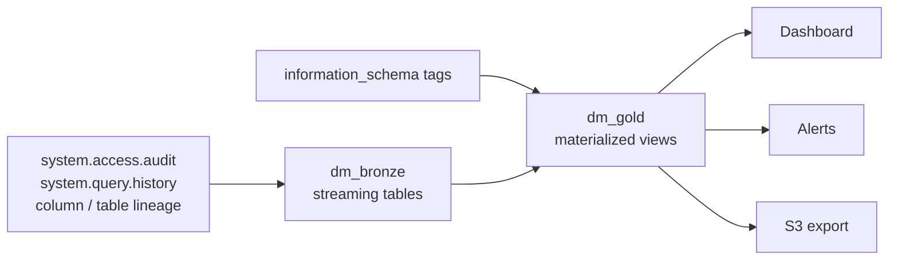

# Download monitor

Finds suspicious data downloads on Databricks: downloads of **PII-tagged data**, **large downloads**, and downloads
from **IP addresses outside an approved list**, from dashboards, the Databricks UI, notebooks and Excel/ODBC
clients, using system tables. Design and reasoning: [PLAN.md](PLAN.md). Build history: [prs/](prs/README.md).



| Piece | Where | Doc |
|---|---|---|
| Bronze streaming tables | `src/download_monitor/bronze/`, `resources/download_monitor/bronze_pipeline.yml` | [bronze.md](bronze.md) |
| Gold materialized views | `src/download_monitor/gold/`, `dm_common/gold_logic.py`, `suspicious_logic.py` | [gold.md](gold.md) |
| Dashboard | `src/download_monitor/dashboards/` | [dashboard.md](dashboard.md) |
| Alerts | `resources/download_monitor/alerts.yml` | [runbook.md](runbook.md) |
| S3 export | `src/download_monitor/export/` | [export.md](export.md) |
| Job | `resources/download_monitor/job.yml` (hourly, paused) | below |

## Deploy and arm

1. Do the checks in [discovery.md](discovery.md) and record decisions in [decisions.md](decisions.md).
2. Enable the `access` and `query` system schemas, turn on **verbose audit logs** in each workspace, and grant the
   run-as principal what [bronze.md](bronze.md) lists plus `BROWSE` on catalogs that carry PII tags.
3. Set the real values, either with `--var` or in `databricks.yml`: `dm_warehouse_id`, `dm_alert_emails`, and the
   approved ranges in `config/download_monitor/supported_ip_ranges.csv` (the shipped row is an example).
   **`deploy.yml` deploys `main` to prod, so do this before merging to `main`.**
4. `databricks bundle deploy -t dev --var dm_bronze_start_date=<recent date>`, then run the `download_monitor` job once
   by hand and check each table.
5. Arm: `--var dm_pause_status=UNPAUSED` (job schedule and the five alerts). Set `dm_export_s3_url` when the export
   is ready ([export.md](export.md)).

## Operating

| To change | Edit | Then |
|---|---|---|
| Approved IPs, thresholds, download actions, client channels, exported columns | `config/download_monitor/*` | `uv run python src/download_monitor/dm_common/build_config.py`, commit both |
| Dashboard layout | `src/download_monitor/dashboards/build_dashboard.py` | `uv run python src/download_monitor/dashboards/build_dashboard.py` |
| Alert thresholds | `resources/download_monitor/alerts.yml` | the high-risk query must keep matching `high_risk_score` (a test checks it) |

Tests: `uv sync && uv run pytest` (the gold, rule, dashboard, alert and export tests run on a local Spark session and
need Java).

## Protecting the monitor's own data

The gold and export tables hold user emails, IPs and query text. Tag them and restrict access:

```sql
ALTER TABLE <catalog>.dm_gold.fct_data_downloads SET TAGS ('PII' = 'user_identity');
ALTER TABLE <catalog>.dm_gold.suspicious_downloads SET TAGS ('PII' = 'user_identity');
REVOKE ALL PRIVILEGES ON SCHEMA <catalog>.dm_gold FROM `account users`;
GRANT USE SCHEMA, SELECT ON SCHEMA <catalog>.dm_gold TO `<security team group>`;
```

(Materialized views may need the tag applied through the pipeline definition or after each full refresh; check on
first deploy. If `PII` is a governed tag, assigning it needs the matching tag permission.)

## Known limits

- **Never run on a real workspace from this repository.** Everything is tested on local Spark fixtures; the items
  marked "not verified" in each doc need one pass in `dev`.
- Downloads from notebook UI actions on classic clusters have no row count (no query history row).
- IPv4 only: IPv6 addresses count as untrusted. `inferred` IP attribution is conservative.
- PII tags are evaluated at the current time, not as of the download.
- Backlog: tag history (SCD2), per-user baselines, IPv6 ranges, geolocation, untagged-PII candidates from data
  classification, a table-update trigger instead of the hourly clock.
