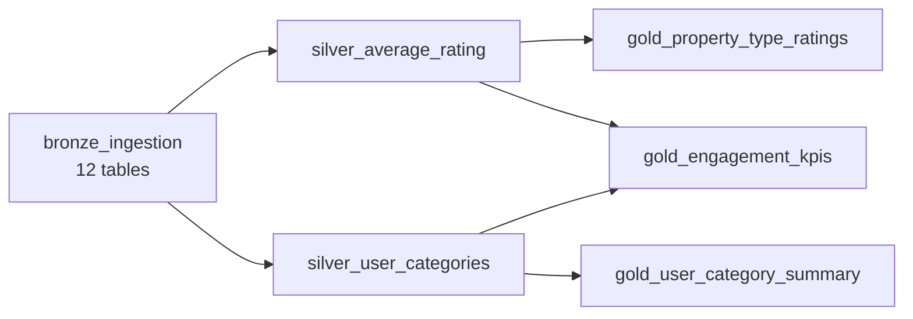

# Orchestrating the medallion pipelines: baseline and three alternatives

The bundle ingests the Wanderbricks sample data (bronze), builds two silver pipelines and three gold
pipelines. This folder compares four ways to orchestrate that graph, each with working code in this repo.

| | Approach | Where the code lives | Deep dive |
|---|---|---|---|
| 0 | **Baseline**: one hand-written job, explicit `depends_on` | `resources/orchestration/medallion_job.yml` | below |
| 4 | **Event-driven**: every pipeline has its own job that waits on a trigger | `resources/orchestration/event_driven.yml` | [event-driven.md](event-driven.md) |
| 5 | **Config-generated**: graph in config, Python generates the jobs at deploy time | `config/orchestration/` + `bundle_gen/` + `resources/__init__.py` | [config-generated.md](config-generated.md) |
| 6 | **Hybrid control plane**: generated domain jobs, For each for repeated work, triggers only between domains | same generator, `config/orchestration/domains.yml` | [hybrid.md](hybrid.md) |

(The numbers 4, 5 and 6 follow the *Orchestration Patterns Deep Dive* you shared.)
[building-blocks.md](building-blocks.md) lists the Databricks mechanisms used, each with a "best use when" and a
"breaks when".

## The graph being orchestrated



It is declared once in [`config/orchestration/nodes.yml`](../../config/orchestration/nodes.yml). Patterns 5 and 6 are
generated from it; the hand-written patterns (baseline, 4) are checked against it by tests.

## How the pieces fit together

All four approaches orchestrate the **same leaf resources** and change nothing in them: the bronze job
`wanderbricks_etl` and its script, and the five pipelines under `resources/silver` and `resources/gold`. The
alternatives only add orchestration jobs on top. That keeps the comparison honest, and it means you can adopt an
approach without touching the pipelines.

| Job prefix | Approach | Count | Default state |
|---|---|---|---|
| `medallion_orchestrator` | baseline | 1 | schedule paused |
| `evt_*` | event-driven | 6 | schedule and triggers paused |
| `gen_*` | config-generated | 4 | schedule paused |
| `hyb_*` | hybrid | 4 | schedule and triggers paused |

Every schedule and trigger of an alternative follows its own pause variable (`event_driven_pause_status`,
`config_generated_pause_status`, `hybrid_pause_status`, all defaulting to `PAUSED`), so deploying them changes
nothing at runtime and you can arm one alternative without the others.

> **Run one orchestration at a time.** They all write the same tables. Two armed at once will start overlapping
> updates of the same pipelines, and the second will fail or wait.

## Scorecard against your rubric

This is a design analysis, not a benchmark: none of it has been run on your workspace (see
[What was and was not verified](#what-was-and-was-not-verified)). "Strong / Partial / Weak" is relative to the
other approaches *for this graph*.

### Benefits of using an orchestrator

| Benefit | Baseline | 4 Event-driven | 5 Config-generated | 6 Hybrid |
|---|---|---|---|---|
| **Reliability** (clear deps, retries, alerts) | Partial: explicit deps, no retries | Partial: retries per job, but a trigger that cannot evaluate runs nothing and alerts nobody | **Strong**: retries, queueing and notification policy applied uniformly; graph validated before deploy | Strong inside a domain, Partial across domains (trigger edges) |
| **Data quality** (checks catch bad data early) | Partial | Partial | Partial | Partial |
| **Transparency** (logs, metrics, lineage) | **Strong**: one graph, one run page | Weak: graph exists only implicitly across N jobs | Strong: one run page per workflow, and the config *is* the graph | Partial: run page per domain; cross-domain needs system tables |
| **Timeliness** (fresh data, on schedule or events) | Partial: fixed clock, waits for the slowest branch | **Strong**: each step starts when its inputs change | Partial: clock or manual, but cheap targeted re-runs | Strong across domains, clock only at the root |
| **Cost efficiency** (no redundant reprocessing) | Partial: refreshes everything every run | Partial: skips unchanged branches, can double-run in bursts | Partial: targeted workflows avoid full re-runs, nothing is skipped automatically | Partial: skips unchanged domains |
| **Governance** (auditable, access, policy) | Partial: one job to permission | Partial: many jobs; run-as needs `SELECT` on every watched table | **Strong**: policy lives in the generator, changes are reviewed as config in git | Strong: per-domain jobs and one generator policy |

Data quality is "Partial" for all four on purpose: the checks that exist are the same in every approach (pipeline
`expect_or_drop` expectations and the bronze row-count check). No orchestration choice adds quality gates by itself.
Pattern 5 and 6 make it *cheap to add* a generated gate task, but I did not build one.

### Key components

| Component | Baseline | 4 Event-driven | 5 Config-generated | 6 Hybrid |
|---|---|---|---|---|
| **Task dependency** | `depends_on` in one job | none: implied by trigger table lists | `depends_on`, computed from `nodes.yml` | `depends_on` inside a domain; trigger between domains |
| **Task types** | Run Job, pipeline | Run Job, pipeline | Run Job, pipeline | pipeline, For each over a Python task |
| **Parameters** | none | none | none (workflow selectors act as parameters) | table list passed to the For each, `{{input}}` per iteration |
| **Schedules** | daily 06:00 UTC | on the bronze job only | on `medallion_full` only | on the root domain only |
| **Triggers** | none | `table_update` on 5 of 6 jobs | none | `table_update` on 3 non-root domains |
| **Control flow** | sequence, parallel branches | none beyond trigger conditions | sequence, parallel; retries; queue | sequence, parallel, **loop** (For each), retries, queue |
| **Conditional runs** | not used | `ALL_UPDATED` condition on triggers | not used | `ALL_UPDATED` condition on triggers |
| **Backfill** | no date in the data model; re-run = idempotent refresh | run a leaf job by hand, downstream reacts automatically | named workflows: `silver_and_gold`, `ratings_chain`, `gold_only` | run a domain job by hand, downstream reacts automatically |
| **Observability** | one run page | per-job runs; join with system tables for end-to-end | one run page per workflow | per-domain runs; join with system tables across domains |
| **Governance** | job permissions via the bundle target | same, multiplied by 6 jobs | same, uniform by construction | same, per domain |

### Selecting an orchestrator

| Criterion | Baseline | 4 Event-driven | 5 Config-generated | 6 Hybrid |
|---|---|---|---|---|
| **Use-case fit** | small stable graph, one team, one clock | upstream timing is unpredictable (late files, other teams' tables) | many similar workflows, shared policy | several teams or domains, mixed clock and event needs |
| **Scalability** | fine to ~dozens of tasks; one run page gets unreadable beyond that | no central graph to outgrow, but trigger limits apply | one job still tops out at the task limit; generation scales job count | shards by domain; designed for very large job counts |
| **Integration** | native | native | native bundles + Python; needs CLI 0.275+ | same as 5 |
| **Ease of use** | **Easiest**: read the YAML | easy per job, hard to see the whole | needs the generator mental model | most moving parts |
| **Maintenance** | edit YAML by hand; copy-paste grows | N near-identical files to keep in sync | change config, tests catch mistakes | same, plus domain boundaries to maintain |
| **Cost to build and run** | lowest | low | medium (generator + tests to maintain) | highest |

Compute cost is similar in all four: every pipeline is serverless and recomputes its materialized view. The
differences above are about avoiding *redundant runs* and about *engineering time*.

## Which one should you pick?

For **this** repo today (six nodes, one daily batch source, one team) the honest answer is that the baseline is
enough, and the alternatives are a way to see what you would be buying:

1. **Stay on the baseline** while the graph is small and one person can read it. Add retries and a failure alert
   to it; that is most of the reliability gain.
2. **Adopt pattern 5 first** when the graph grows or you want the same policy everywhere. It is the smallest step
   up: the output is the same kind of job you already have, and the config it needs also feeds pattern 6.
3. **Adopt pattern 6** when different teams own different parts of the graph, or the number of workflows heads
   toward hundreds. Domain jobs give each team its own run page and permissions.
4. **Use pattern 4 for individual edges** where upstream timing really is unpredictable (files landing from
   another team, a table another job refreshes), not as the whole control plane. Its weakness is that nobody can
   see the graph.

The patterns mix: pattern 6 *is* patterns 4 and 5 combined with For each. The sample data here is loaded by one
job on one clock, so the event-driven edges demonstrate the mechanism more than they earn their keep.

## What was and was not verified

I could not install the Databricks CLI or reach your workspace from the environment this was built in, so nothing
has been through `databricks bundle validate` or `deploy`.

**Verified offline (37 tests, `uv run pytest`):**

- The generated `gen_medallion_full` has exactly the baseline's tasks, edges and targets.
- The hand-written event-driven YAML watches exactly what `nodes.yml` says each pipeline reads (mutation-tested:
  dropping a table from a trigger fails the test).
- Every generated job parses with the `databricks-bundles` job schema (`Job.from_dict`).
- `resources:load_resources` runs through the same `databricks.bundles.build` entrypoint the CLI uses.
- Every `${var.*}` and `${resources.*}` reference in generated and hand-written orchestration resolves.

**Not verified; check these on the first `databricks bundle validate -t prod` and deploy:**

- Table-update triggers may require the watched tables to exist when the job is created. Run the baseline once
  before the first deploy of the alternatives.
- Whether a trigger on a **materialized view** fires when its pipeline refreshes it. The docs list tables; I did
  not confirm MVs.
- `max_retries` on pipeline tasks, `queue.enabled`, and a For each iteration passing `{{input}}` into a Python
  task's parameters are standard job settings, but are unexercised here.
- Relative script paths for Python-generated resources resolve against `resources/__init__.py`, which is where
  the resources are registered. The path itself is checked by a test.
- The numeric limits quoted in the deep dives come from Databricks docs and change. Re-check before relying on
  them.

## Try it

```bash
uv sync                                   # installs databricks-bundles + pyyaml into .venv
uv run pytest                             # offline checks
databricks bundle validate -t prod        # needs CLI 0.275+
```

To arm one alternative, deploy with its variable set, for example
`databricks bundle deploy -t prod --var hybrid_pause_status=UNPAUSED`. The CI `deploy` workflow uses the defaults
(all `PAUSED`), so merging changes nothing at runtime. Arming from CI means editing the variable default or
passing `--var` in `deploy.yml`.
