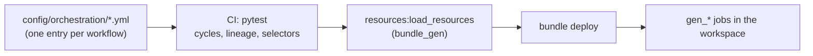

# Pattern 5: generated from config

> Code: [`config/orchestration/nodes.yml`](../../config/orchestration/nodes.yml),
> [`workflows.yml`](../../config/orchestration/workflows.yml) ·
> [`bundle_gen/catalog.py`](../../bundle_gen/catalog.py), [`flat.py`](../../bundle_gen/flat.py) ·
> [`resources/__init__.py`](../../resources/__init__.py) · tests: `tests/test_catalog.py`, `tests/test_flat.py` ·
> overview and scorecard: [README](README.md)

## The idea

The workflow definitions live in git as plain config. A small generator turns them into jobs at deploy time. This
is a **layer, not a runtime mechanism**: what lands in the workspace is ordinary jobs, the same kind as the
baseline's. The value is in how they are produced.

This is the same family as the config-driven approach in the community post you linked
([Dynamic Workflow Creation Using a Config-Driven Approach](https://community.databricks.com/t5/technical-blog/dynamic-workflow-creation-using-a-config-driven-approach/ba-p/119839)).
I could not open that post from the environment this was built in, so I am not claiming this matches its code.
The deep dive you shared describes it as an SDK script reading a config table. This repo implements the same idea
with **Python for bundles** instead, which keeps the generated jobs inside bundle state (see the trade-off table
below).



## The code in practice

**1. The graph is data.** One entry per node, edges as `depends_on`, and tables read and written:

```yaml
- id: gold_engagement_kpis
  layer: gold
  domain: executive_kpis
  kind: pipeline
  pipeline: gold_engagement_kpis
  depends_on: [silver_average_rating, silver_user_categories]
  reads: [silver.average_rating, silver.user_categories]
  writes: [gold.engagement_kpis]
```

**2. A workflow is a selection of that graph.** Four workflows, 19 lines, replace what would otherwise be four
hand-maintained jobs:

```yaml
- name: ratings_chain
  description: Refresh silver average_rating and everything downstream of it.
  select: { downstream_of: [silver_average_rating] }
```

That generates `gen_ratings_chain` with three tasks. The edge `silver_average_rating -> gold_engagement_kpis` is
kept; the edge from the *other* silver pipeline is dropped because that node is not selected. The other
workflows are `medallion_full` (everything, scheduled), `silver_and_gold` (re-run after fixing bronze, without
reloading it) and `gold_only`.

**3. The generator is a plain function that returns dicts**, so it is unit-testable without a workspace:

```python
def pipeline_or_job_task(node, depends_on, retries):
    task = {"task_key": node.id}
    if depends_on:
        task["depends_on"] = [{"task_key": d} for d in depends_on]
    if node.kind == "ingest":
        task["run_job_task"] = {"job_id": f"${{resources.jobs.{node.job}.id}}"}
    else:
        task["pipeline_task"] = {"pipeline_id": f"${{resources.pipelines.{node.pipeline}.id}}"}
        task.update(retries)  # retries only on pipeline tasks
    return task
```

**4. The CLI entrypoint** registers the generated jobs. `databricks.yml` points the CLI at it:

```yaml
python:
  venv_path: .venv
  resources:
    - "resources:load_resources"
```

```python
def load_resources(bundle: Bundle) -> Resources:
    resources = Resources()
    catalog = load_catalog(CONFIG_DIR / "nodes.yml")
    workflows = build_workflow_jobs(catalog, load_yaml(CONFIG_DIR / "workflows.yml"))
    ...
    for key, job in {**workflows, **domains}.items():
        resources.add_resource(key, Job.from_dict(job))
    return resources
```

**5. Validation happens before anything is deployed.** The catalog rejects, with every problem listed at once:
dependency cycles, unknown dependencies, a node depending on a *later* layer, duplicate ids, and a node that reads
a table no upstream node writes. That last check is the one that catches "I renamed a table and forgot a
consumer".

**What generation buys, measured against the baseline.** `gen_medallion_full` is verified by a test to have the
same tasks, edges and targets as the hand-written baseline, plus uniform retries, queueing and an optional
`notify_on_failure` list per workflow. Adding the three extra workflows cost 15 lines of config, not three jobs.

## Pros

- **Policy once.** Retries, queueing, tags and notifications are applied by the generator to every job. Changing
  them is one code change, not N file edits.
- **One reviewable source of truth.** A pull request changes `nodes.yml`; reviewers read the graph change, and
  `git blame` on the config answers "who added this dependency and when". Strong for governance and audit.
- **Cheap variants.** A new workflow (re-run silver and gold, one lineage branch, gold only) is three lines. This
  is also the cleanest answer to *backfill*: the right subset is a named, tested, reviewable workflow.
- **Validated before deploy.** Cycles, bad references and lineage gaps fail CI, not a 6am run.
- **Scales job count.** The platform allows many thousands of jobs; a generator is how you create them without
  thousands of hand-written files.
- **Portable.** The same `nodes.yml` drives pattern 6 and the drift test for pattern 4, so the graph is declared
  once for all approaches.

## Cons

- **A build-time dependency.** Deploy now runs your Python. You need Databricks CLI 0.275 or later, and
  `uv sync` must have created `.venv` (with `databricks-bundles` and `pyyaml`) before `bundle validate` or
  `deploy`. The CI workflows already run `uv sync`; local setups must too.
- **Indirection hurts debugging.** The job you see in the workspace is not in any file. Reviewers must trust or
  inspect the generator; regressions can hide in code that is not a config diff. Mitigation: the equivalence test
  against the baseline, and reading the resolved config with `databricks bundle validate -t prod -o json`.
- **The generator is code you now own.** 580 lines of Python plus 489 lines of tests in this repo, against 53
  lines of YAML for the baseline. That is only worth it when it replaces *many* hand-written jobs.
- **Still one flat graph per workflow.** A single job with hundreds of tasks is hard to read and has a hard
  per-job task limit. Generation does not change the shape of the job; pattern 6 does.
- **Limits at scale.** Creating jobs is rate-limited, and the workspace caps saved jobs, so very large
  generated sets need sharding across workspaces.
- **Python for bundles status.** The docs I read do not label it GA or Beta, so check its status before you
  depend on it for production.
- **Not event-driven by itself.** It generates the *shape* of orchestration. Timing still comes from schedules,
  manual runs or triggers you add (pattern 6 adds them).

## Three ways to generate jobs

| Option | Best use when | Breaks when |
|---|---|---|
| **YAML bundles only** | the graph is small and stable | many similar jobs: copy-paste drift |
| **Python for bundles** (this repo) | you want loops and shared policy, and the jobs must stay inside bundle state, diffs and permissions | the team cannot own a Python build step, or CLI/runtime versions are pinned below 0.275 |
| **SDK script from a config table** | job definitions change at runtime or per request, with per-task compute and notebook choices | you need drift detection: jobs created by a script sit outside bundle state, so you own reconciliation |

The SDK-script row is how the deep dive characterises the community post; I could not read the post myself.

## Breaks when

| Situation | Why |
|---|---|
| A workflow exceeds the per-job task limit or becomes unreadable | generation keeps one flat DAG per workflow |
| Someone edits a generated job by hand in the UI | the next deploy overwrites it; lock down edit permissions |
| CI or a laptop lacks the venv or the right CLI version | `bundle validate` fails before it reaches Databricks |
| A single config change can alter hundreds of jobs | the blast radius is large; keep config changes small and the tests strict |
| Pipelines need runtime decisions (skip a branch if upstream is empty) | generation is deploy-time only; use task conditions in the job |

## Best use when

- You have, or expect, many workflows with shared policy (retries, alerts, tags, permissions).
- You want the graph reviewed as data in pull requests and validated in CI.
- You need cheap targeted re-runs (backfills, partial refreshes) as named, tested workflows.

## Rubric: how this approach scores

- **Benefits**: reliability and governance strong (uniform policy, validated graph, reviewed config);
  transparency strong per workflow (one run page each, config is the graph); timeliness partial (no events by
  itself); data quality partial (same expectations as the baseline; a generated quality gate task would be an easy
  addition, but is not built).
- **Components**: dependency, parameters-as-selectors, retries and queueing native; schedule on one workflow;
  backfill as named workflows.
- **Selection**: build and maintenance cost is the highest of the flat options and pays off with volume; ease
  of use is good once the model is learned.
