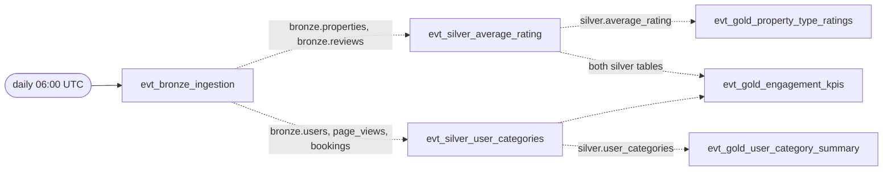

# Pattern 4: event-driven triggers

> Code: [`resources/orchestration/event_driven.yml`](../../resources/orchestration/event_driven.yml) ·
> drift test: [`tests/test_event_driven_yaml.py`](../../tests/test_event_driven_yaml.py) ·
> overview and scorecard: [README](README.md)

## The idea

Nothing central calls anything. Every pipeline gets its own job, and each job declares **what it waits for**: a
table-update trigger on the tables the pipeline reads. Only the root (bronze) is on a clock.



Dotted arrows are not edges in any file. They are *implied* by one job writing a table that another job watches.

## The code in practice

One job per pipeline. This is the whole definition of the gold KPI job:

```yaml
evt_gold_engagement_kpis:
  name: evt_gold_engagement_kpis
  max_concurrent_runs: 1
  queue: { enabled: true }
  trigger:
    pause_status: ${var.event_driven_pause_status}
    table_update:
      condition: ALL_UPDATED          # both silver tables must have changed
      wait_after_last_change_seconds: 60
      min_time_between_triggers_seconds: 300
      table_names:
        - ${var.catalog}.${var.silver_schema}.average_rating
        - ${var.catalog}.${var.silver_schema}.user_categories
  tasks:
    - task_key: gold_engagement_kpis
      max_retries: 1
      pipeline_task:
        pipeline_id: ${resources.pipelines.gold_engagement_kpis.id}
```

What each setting buys you here:

- `ALL_UPDATED` is a **join**: this job runs only after *both* silver tables have changed. The baseline gets the
  same effect from `depends_on` on two tasks.
- `wait_after_last_change_seconds` and `min_time_between_triggers_seconds` debounce bursts, so a bronze load that
  touches many tables does not start a run per table.
- `queue` plus `max_concurrent_runs: 1` stops a trigger that fires during a run from being dropped.
- Adding a new consumer is one new job; it does not touch any other job. That is the pattern's real selling
  point.

Because the graph has no home, [`tests/test_event_driven_yaml.py`](../../tests/test_event_driven_yaml.py)
reconstructs it from the trigger table lists and compares it with `config/orchestration/nodes.yml`. I
mutation-tested it: delete one table from a trigger and the test fails. Without a test like this, nothing notices
when the implied graph drifts.

## Pros

- **Timeliness**: each step starts when its inputs actually change, with no idle gap waiting for a clock and no
  waiting for the slowest unrelated branch.
- **Loose coupling**: teams add a consumer without editing the producer's job or any parent job.
- **Cost**: unchanged branches do not run. (Here every pipeline is a full-recompute materialized view, so the
  saving is small; it grows with expensive, rarely-changing branches.)
- **Natural cascades**: running one leaf job by hand updates its table, and everything downstream reacts on its
  own. That is a free "re-run from here" for backfills.
- **Simple per job**: a job is a trigger, a task and a retry. Easy to read in isolation.

## Cons

- **Transparency is the weak point.** There is no single place that shows the graph, and no single run page for
  "the whole nightly load". To answer "did everything finish today?" you join six jobs' histories (system tables)
  or lineage. The baseline answers it with one page.
- **Silent failures.** The documented examples: a table trigger whose run-as principal lacks `SELECT` on a
  watched table fails to *evaluate*, so the job simply never runs, and nothing fails visibly. A downstream job
  whose upstream failed also just never fires. Failure notifications on the *job* only fire when a run exists.
  You need a "no run in the expected window" check, which this repo does not include yet.
- **Many near-identical files.** Six jobs, 120 lines of YAML, versus 53 for the baseline. Changing a shared
  setting (retries, queue, notifications) means editing every file; that repetition is what pattern 5 removes.
- **Events mean "data changed", not "pipeline ran".** If a materialized view refresh produces no new table
  version, downstream does not fire even though the pipeline succeeded. That is usually fine but surprising.
- **No business-date awareness.** A trigger cannot say "wait for *today's* partition". Date-sensitive edges need
  a different mechanism (see [hybrid.md](hybrid.md), the readiness-table idea).
- **Bootstrap order.** Triggers watch tables, and those tables must exist when the job is created. Run the
  baseline once before the first deploy.
- **Nothing else is stopping a double-run.** `ALL_UPDATED` plus debounce reduce duplicate runs but do not remove
  them; a slow bronze load can still start silver twice.

## Breaks when

| Situation | Why |
|---|---|
| You need one view of the end-to-end run, an SLA on "all done by 8am" | no parent run exists; reconstruct from system tables |
| An edge depends on a business date or batch id | triggers match tables, not dates |
| The number of event jobs reaches the platform trigger limits | the docs cap active triggers per workspace and tables per trigger (check the current numbers) |
| Teams can't agree who owns the failure when a trigger quietly stops | there is no job whose failure means "the chain stopped" |
| Producers write tables you do not control, with no stable table version change | the trigger never fires |

## Best use when

- Upstream timing is genuinely unpredictable (data lands from another team, files arrive irregularly).
- Edges are few and cross team boundaries, so a shared parent job would be an organizational problem.
- You can afford the monitoring that replaces the missing parent run page.

In this repo the source is one daily batch on one clock, so this pattern is mostly a demonstration of the
mechanism. It earns its place on *individual* cross-team edges, which is exactly how the hybrid pattern uses it.

## Rubric: how this approach scores

- **Benefits**: timeliness strong; reliability partial (silent non-firing); transparency weak; governance
  partial (run-as needs `SELECT` on every watched table, permissions repeat per job).
- **Components**: dependencies implicit; triggers native; schedules only at the root; conditional runs through
  trigger conditions; backfill by running a leaf; observability needs system tables.
- **Selection**: easy per job, hard as a whole; maintenance grows with the file count; build cost lowest.
