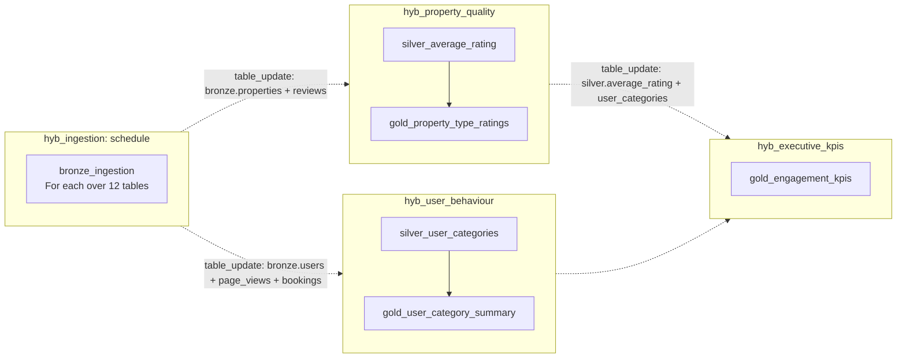

# Pattern 6: hybrid control plane

> Code: [`config/orchestration/domains.yml`](../../config/orchestration/domains.yml) ·
> [`bundle_gen/hybrid.py`](../../bundle_gen/hybrid.py) · [`resources/__init__.py`](../../resources/__init__.py) ·
> tests: `tests/test_hybrid.py`, `tests/test_bundle_wiring.py` · overview and scorecard: [README](README.md)

## The idea

Use each mechanism where it is strongest:

- **Edges inside a domain** use `depends_on` in a parent job, so you get one run page, one repair, one graph per
  domain.
- **Repeated work** uses a **For each** task: one generic loader, many inputs.
- **Edges between domains** use **triggers**, so a team can add a consumer without editing anyone else's job.
- **All of it is generated** from the same graph as pattern 5, so the policy is applied once.

This is a combination of patterns 4 and 5 and For each. It is my design, not a Databricks reference
architecture.

## What gets generated for this graph

Domains come from the `domain` field in `nodes.yml`:



Solid lines are `depends_on` inside one job. Dotted lines are triggers on a *different* job. The KPI node is
the interesting one: its two upstreams are in two other domains, so it has **no `depends_on` at all** and starts
when both silver tables have changed.

## The code in practice

**Config: only what is not already in the graph.** Edges and tables come from `nodes.yml`; `domains.yml` adds the
timing:

```yaml
domains:
  - name: ingestion
    schedule: { cron: "0 0 6 * * ?", timezone: UTC }
    ingest:
      concurrency: 4               # tables loaded in parallel by the For each task
  - name: executive_kpis
    entry:
      via: table_update
      condition: ALL_UPDATED       # every watched table must have changed
      wait_after_last_change_seconds: 60
      min_time_between_triggers_seconds: 300
```

**The watched tables are derived, not typed.** A domain's entry nodes are those with an upstream in another
domain; the trigger watches what they read. Rename a table in `nodes.yml` and every trigger follows:

```python
def entry_tables(catalog: Catalog, domain: str) -> list[str]:
    refs = []
    for node in catalog.domain_nodes(domain):
        if catalog.external_dependencies(node):
            if not node.reads:
                raise CatalogError(f"node '{node.id}' has a cross-domain dependency but declares no 'reads', ...")
            refs.extend(r for r in node.reads if r not in refs)
    return [table_ref(r) for r in refs]
```

**The bronze loader becomes a For each, with no change to the script.** The existing loader already accepts a
comma-separated `--tables`, so each iteration passes a single table:

```python
"for_each_task": {
    "inputs": json.dumps(tables),          # the bundle variable `tables`, split
    "concurrency": concurrency,
    "task": {
        "task_key": f"{node.id}_table",
        "environment_key": "default",
        "spark_python_task": {
            "python_file": INGEST_SCRIPT,
            "parameters": [..., "--tables", "{{input}}"],
        },
    },
},
```

Compared with the baseline's loop *inside* one task, each table is now its own visible iteration, loads
in parallel (4 at a time). The semantics are the same as before: other tables still load and the job fails at
the end. Whether a repair re-runs only the failed iterations is not something I confirmed in the docs, so test
it before promising per-table repair.

**The generator refuses inconsistent topology**, with tests for each: a root domain without a schedule, a
non-root domain without an `entry`, a domain with both, a cross-domain node with no `reads`, and domains that
depend on each other in a cycle (checked at domain level, which can fail even when the node graph is acyclic).

## Pros

- **Right tool per edge.** Tightly coupled steps get a graph, loosely coupled teams get events. You are not
  forced to choose pattern 4 or the baseline for everything.
- **Ownership boundaries.** One job per domain means a run page, permissions and notifications per team. The
  property-quality team can repair its job without touching user behaviour.
- **Smaller blast radius.** A failure in one domain does not fail an unrelated domain's run, and the KPI job is
  not even started if a silver table did not change.
- **Loops are first-class.** The For each turns "same notebook, many parameters" into one definition; adding a
  bronze table is a change to the `tables` variable, not new code.
- **Policy once, graph once.** Same generator and same `nodes.yml` as pattern 5, plus the drift tests.
- **Scales out.** Domain jobs can be sharded across workspaces by domain group when job or trigger counts
  require it, with all of them on one metastore.

## Cons

- **Most moving parts.** Generator, For each, three trigger edges, queueing and domain config. This is the
  highest build and learning cost of the four.
- **No single end-to-end run.** Cross-domain edges have no parent run. "Did everything finish today?" needs
  system tables or lineage. The baseline and pattern 5 answer it with one page.
- **Inherits pattern 4's silent failures** on the cross-domain edges: a trigger that cannot evaluate, or an
  upstream that failed, just means the downstream domain never runs. You need failure alerts on every domain
  job *and* a "no run in the window" check.
- **Events say "data changed", not "all of today's data is here".** With `ALL_UPDATED` the KPI job waits for both
  silver tables, but not for a specific date. If correctness depends on a business date, a trigger is the wrong
  tool for that edge; the deep dive suggests a small **readiness table** (one row per dataset and date written by
  the producer, read by a SQL condition on the trigger). I did not build it, because this dataset has no date
  dimension, and whether a SQL condition can see which row fired the trigger is not confirmed in the docs I read.
- **Boundaries can be wrong.** Domains are a modelling decision. If they do not match how teams own the data,
  you pay for the cross-domain edges and get nothing back. Here, "property quality" and "user behaviour" are my
  grouping, not your org chart; change `domain:` in `nodes.yml` and the jobs regenerate.
- **Same bootstrap and arming rules as pattern 4**: watched tables must exist when triggers are created, and
  triggers are created paused (`hybrid_pause_status`).
- **Some platform pieces I could not confirm** (see the README): table-update triggers on materialized views,
  and the For each `{{input}}` into a Python task, are standard but unexercised here.

## Breaks when

| Situation | Why |
|---|---|
| One domain has hundreds of tasks | a domain job is still a flat graph; split the domain |
| Many triggers per workspace | platform limits on active triggers and watched tables apply; shard by domain group |
| The cross-domain edge needs a business date or batch id | a trigger watches tables, not dates; use a readiness table or keep the edge inside one parent job |
| For each inputs are large | there are documented size limits on the inputs; use a lookup task instead of an inline list |
| Domain ownership changes often | job names, permissions and triggers all move; the generator makes that cheap but not free |
| Nobody owns monitoring the quiet edges | the pattern's failure mode is a missing run, not an error |

## Best use when

- Several teams or domains own different parts of one graph, but each domain internally is a tight workflow.
- Some edges are best on a clock, some on data arrival, and some on completion; you want to choose per edge.
- The workflow count is heading toward hundreds or thousands and a flat job cannot hold it.

Not worth it for the six-node graph here on its own; it is the shape the graph can grow into without changing
the pipelines.

## Rubric: how this approach scores

- **Benefits**: reliability strong inside a domain, partial across; transparency partial (per-domain run pages);
  timeliness strong across domains; governance strong (per-domain jobs plus one generator policy); cost partial.
- **Components**: dependencies (`depends_on` and triggers), triggers, **control flow including loops**, schedules
  at the root only, backfill by running a domain job (downstream reacts by itself), observability via system
  tables across domains.
- **Selection**: best scalability and fit for multi-team use; highest build and maintenance cost; hardest to
  explain to a new engineer.
